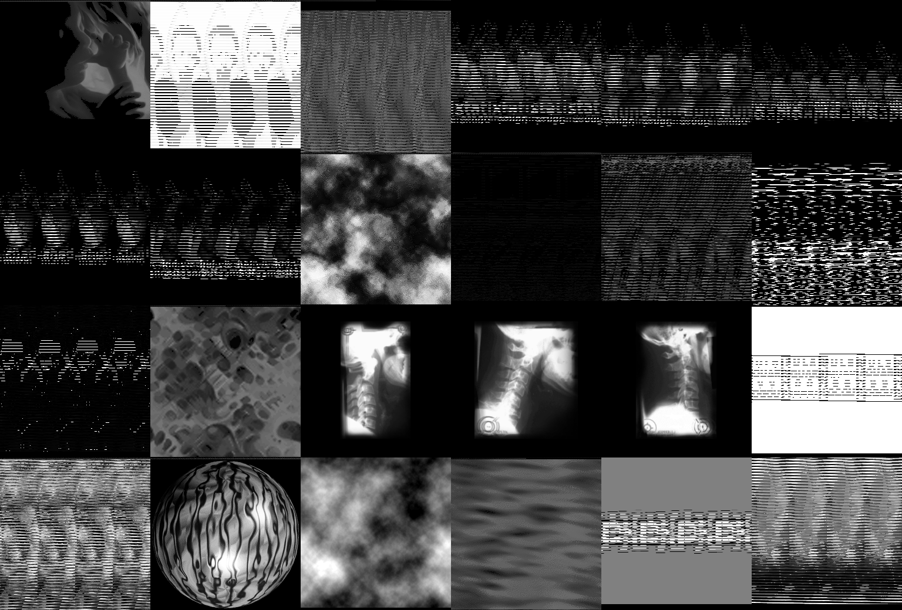
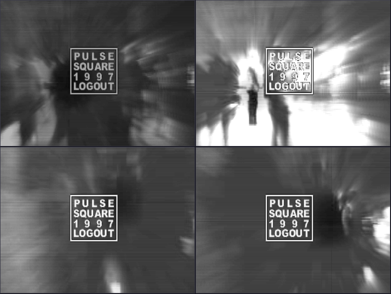

# SQUARE - effects (inventory, not yet ported)

The scene list below comes from the file names the code loads (strings 0x101000-0x102500) and the order of the scene calls in `main`; the effects themselves are not analysed yet.

Canyon fly-through (`canyon.fpl/.fbp/.fad`), molecules (`caffeine`, `ecstasy`, `c6h12o5`, `dna` `.mol`), pinblob, cubes (`cubes.fpl`, `rayes`, `back2`), planet (`plnt.*`, `sunflare`), brain / x-ray vertebrae (`senseof`, `braino2`, `dunetex`), tunnel (`tunnel.gst/.fad`, `krol1..3`), bjork scene (`cr1..5`, `palflow`, `*bulbe/*spike.dat`), plasma, title/logo, people (`people.lzw`), the "secret zebou" picture (`zebou.lzw`).
Music: `SQUADEMO.XM`, 263 s, 56 orders. The code reads the music position as order*64+row, so every scene is a function of music position and a 60 Hz tick counter.

## The people scene (ported)

Last scene (`0x390ab`, from 3:38): 117 grey DCT frames from `PEOPLE.LZW` (`web/js/lzw.js` + `dct.js`) are cross-faded with a sine-modulated brightness (`people.js`), the 160x120 window is doubled to 320x240, then a **radial zoom blur** (`blur.js`, guest `0x2a8e8` + the generated code at `0x58000`) smears each pixel along a bilinear sample taken toward a centre that two sums of three sines wander around, and the PULSE / SQUARE / 1997 / LOGOUT box from `logo.raw` (read from the original `SQUARE.PAK` in the browser) is stamped on top. Blend, upsample, blur and logo are bit-exact against the original run under Unicorn; the frame position and the palette fade-in are modelled. See `re/NOTES.md` (Session 5).

## Scenes run from the recompiled original code (session 6)

The opening **portrait** scene (0x29a81, 0:00-0:21, shown 320x480 on a 4:3 screen) and the **dune** scene (0x338a5, 3:28-3:32: the texture dunetex.raw scaled by a double, a ramp, noise 0x1e27a and the radial blur 0x2a8e8, palette crossfade by the ISR) are not ported to hand-written effects: the player runs their original code translated to JS (`web/js/sqr.gen.mjs`) frame by frame, on a 43-51 KB entry snapshot and the original SQUARE.PAK. The result matches the original's frames bit for bit (749 of 752 flips; the DAC palette writes are identical) but it is not an understanding of the effect: for the portrait scene the per-pixel loop 0x29ea8 (`dst[i] = lut[(((a[i]<<2)+b[i])<<8)+c[i]]` with a random row offset, then the line drawer 0x2c25b and the blend 0x31c33 for the title) was what cost the 70-90 ms per frame in JS; it, the 4-neighbour blur and the blend are now hand-written JS patches (re/patches.env), 8 ms per frame.
